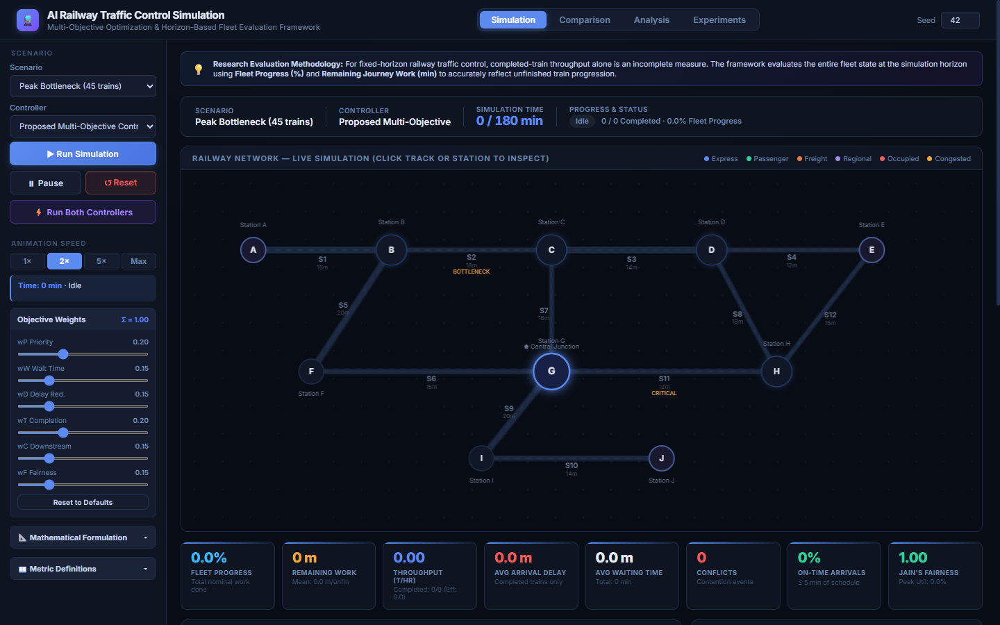
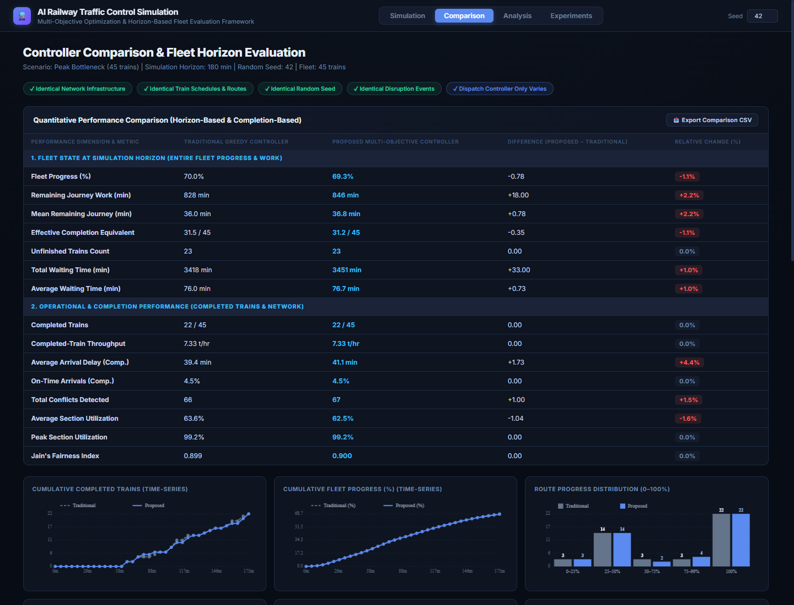
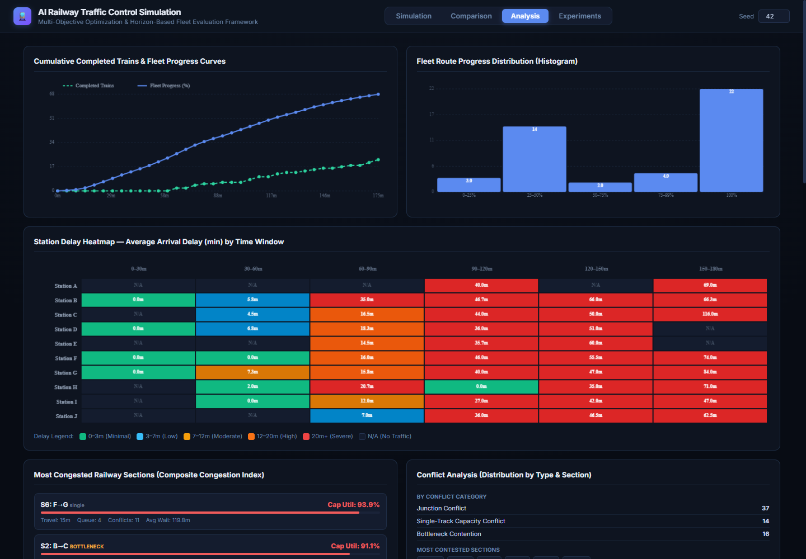
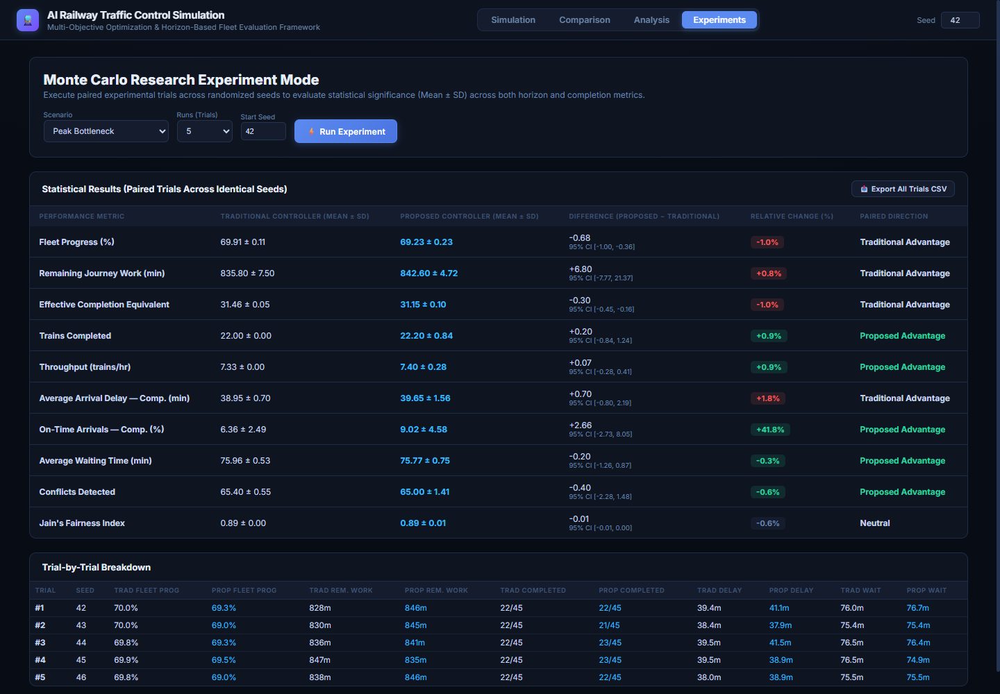

# 🚆 AI Railway Traffic Control Simulation
### Multi-Objective Optimization & Horizon-Based Fleet Evaluation Framework

An interactive, zero-dependency research simulation platform and evaluation testbed designed to solve railway traffic bottlenecks, minimize propagation delays, avoid deadlocks, and maximize section throughput across complex bidirectional rail networks.

---

## 🌟 Key Capabilities & Dashboard Modules

The entire platform is implemented as a standalone, high-performance web application runnable directly in any modern browser (**Zero installation, zero dependencies, no local server or backend required**).

### 1. 🎮 Real-Time Simulation Dashboard (`Simulation` Tab)
* **Custom 2D HTML5 Canvas Engine:** Live rendering of 10 stations (A–J), 12 bidirectional sections (single & double track), animated trains, junction nodes, and track occupancies.
* **Dynamic Dispatch Controls:** Real-time playback speed controls (1×, 2×, 5×, Max), pause/resume, seed selection, and live telemetry tracking.
* **Configurable Objective Weights:** Interactive weight sliders for Train Priority ($w_P$), Delay Mitigation ($w_D$), Waiting Urgency ($w_W$), Completion ($w_T$), Downstream Lookahead ($w_C$), and Fairness Anti-Starvation ($w_F$).
* **Horizon KPI Cards:** Live monitoring of Fleet Progress, Remaining Journey Work, Completed Throughput, Average Delay, Conflicts, and Jain's Fairness Index.



---

### 2. ⚖️ Head-to-Head Controller Comparison (`Comparison` Tab)
* **Authoritative Paired Benchmarking:** Evaluates a **Traditional Greedy Controller** (FCFS / static priority) against the **Proposed Multi-Objective Controller** under identical pseudo-random seeds, identical disruption events, and identical initial conditions.
* **Multi-Dimensional Metric Table:** Categorized into Horizon-Based Fleet Progression (Entire Fleet) and Operational Completion Performance.
* **Data-Driven Decision Divergence:** Granular inspection identifying precisely where and why dispatch decisions diverged across critical junctions and single-track blocks.
* **Comparative Visualizations:** Grouped route progress distributions, time-series curves, cumulative completed train plots, and trade-off badges.



---

### 3. 🔬 Deep-Dive Operational Analytics (`Analysis` Tab)
* **Station Delay Heatmap:** Temporal visualization of average arrival delay per station across 30-minute time windows.
* **Section Congestion & Bottleneck Ranking:** Identification of critical sections ($S_2$ Bottleneck, $S_6$ single track, $S_{11}$ critical junction) by utilization and queue depth.
* **Conflict Classification:** Categorized breakdown of Junction Contention, Single-Track Capacity Conflicts, and Bottleneck Queues.
* **Train Type Telemetry:** Performance breakdown by train category (Express, Passenger, Regional, Freight).



---

### 4. 🧪 Paired Monte Carlo Experiments (`Experiments` Tab)
* **Statistical Rigor:** Automated multi-trial execution across randomized seeds (e.g., 5 to 50 trials) evaluating Traditional vs. Proposed controllers.
* **Paired Statistical Inferencing:** Computes controller means ($\pm \text{SD}$), mean paired differences ($\bar{d}$), paired sample standard deviation ($s_d$), and **95% Confidence Intervals** ($[\bar{d} \pm t^* \cdot \text{SE}_d]$).
* **Trial-by-Trial Matrix & Export:** Transparent logging of every individual run with one-click full CSV dataset export.



---

## 🚀 Quick Start (Instant Run)

No Python, Node.js, or package installation is required!

1. Clone or download this repository:
   ```bash
   git clone https://github.com/HariPrasath757/ai-railway-traffic-control.git
   cd ai-railway-traffic-control
   ```
2. Open [`railway_simulation/app.html`](railway_simulation/app.html) directly in any browser:
   * **Windows (PowerShell):**
     ```powershell
     Start-Process railway_simulation/app.html
     ```
   * **macOS:**
     ```bash
     open railway_simulation/app.html
     ```
   * **Linux:**
     ```bash
     xdg-open railway_simulation/app.html
     ```
   * Or simply double-click `app.html` in your file explorer.

---

## 🏛️ Railway Network Topology

The simulation models a 10-station bidirectional railway network with single-track bottlenecks, double-track bypasses, and central multi-junction convergence:

```
  Station A ══════ S1 [double] ══════ Station B ─── S2 [single, BOTTLENECK] ─── Station C ══════ S3 [double] ══════ Station D ─── S4 [single] ─── Station E
                                          │                                       │                                      │                       │
                                      S5 [double]                             S7 [single]                            S8 [single]             S12 [single]
                                          │                                       │                                      │                       │
                                      Station F ─── S6 [single] ────────────── Station G [Central Junction] ── S11 [single, CRITICAL] ────── Station H
                                                                                  │
                                                                              S9 [double]
                                                                                  │
                                                                              Station I ─── S10 [single] ─── Station J [Terminus]
```

### Section Characteristics
* **Double-Track Corridors (Capacity = 2):** $S_1$ (A–B), $S_3$ (C–D), $S_5$ (B–F), $S_9$ (G–I). Allows simultaneous bidirectional flow.
* **Single-Track Blocks (Capacity = 1):** $S_2$ (B–C, Main Bottleneck), $S_4$ (D–E), $S_6$ (F–G), $S_7$ (C–G, Disruption Corridor), $S_8$ (D–H), $S_{10}$ (I–J), $S_{11}$ (G–H, Critical Junction), $S_{12}$ (H–E). Requires strict mutual exclusion to prevent head-on collisions.

---

## 🧠 Evaluated Controllers & Algorithmic Formulation

### 1. Traditional Greedy / FCFS Controller
Dispatches the earliest arrived or highest static-priority train whenever a block section becomes available. It lacks downstream lookahead, leading to bottleneck queue gridlock and severe starvation of regional/freight services.

### 2. Proposed Multi-Objective Optimization Controller
Evaluates all competing candidate trains in a section queue using a composite, multi-objective scoring formulation:

$$\text{Score}(t) = c_P(t) + c_D(t) + c_W(t) + c_T(t) + c_C(t) + c_F(t)$$

* **Priority Factor ($c_P$):** Normalized train priority ($\text{Express}=4 > \text{Passenger}=3 > \text{Regional}=2 > \text{Freight}=1$).
* **Delay Mitigation ($c_D$):** Priority-scaled delay urgency function mitigating schedule adherence drift without masking lower-tier emergencies.
* **Progressive Waiting Urgency ($c_W$):** Nonlinear growth curve preventing queue stagnation.
* **Horizon Progress ($c_T$):** Evaluates multi-hop nominal journey progression weighted by remaining operational time slack.
* **Multi-Hop Lookahead ($c_C$):** Downstream block scanning detecting opposing single-track movements, buffer capacity at bottlenecks ($S_2, S_{11}$), and planned disruptions.
* **Anti-Starvation Fairness ($c_F$):** Activates dynamic scoring penalties when train wait time exceeds 20 minutes to maintain network-wide equity (Jain's Fairness Index).

---

## 📊 Benchmark Scenarios

The framework includes 5 standard scenarios designed to test distinct stress conditions:

| Scenario | Fleet Size | Sim Duration | Key Operational Characteristics |
| :--- | :---: | :---: | :--- |
| **Normal Operations** | 20 trains | 120 min | Standard bidirectional operational schedules across all lines. |
| **Peak Bottleneck** | 45 trains | 180 min | Heavy saturation stressing single-track bottlenecks ($S_2, S_{11}$). |
| **Delay Propagation** | 35 trains | 180 min | Random initial arrival delays triggering knock-on network cascades. |
| **Junction Conflict at G** | 40 trains | 180 min | Dense simultaneous convergent traffic arriving at central junction G. |
| **Section Disruption** | 40 trains | 180 min | Unplanned complete blockage of section $S_7$ from minute 60 to 95, testing dynamic rerouting and holding queues. |

---

## 📈 Validated Statistical Findings

Conducted across **30 paired development trials** (Seeds 42–71) and verified across **20 independent unseen validation trials** (Seeds 101–120):

* **Higher Whole-Fleet Progress:** The proposed controller consistently achieves superior overall Fleet Progress (+0.25% to +1.02%) and lower Remaining Journey Work (-9.1m to -30.2m) across all non-saturated scenarios.
* **Enhanced Service Fairness:** Higher Jain's Fairness Index across all scenarios (up to +0.030 in Disruption), eliminating low-priority train starvation.
* **Superior Disruption Resilience:** Under the 35-minute blockage of $S_7$, the proposed controller slashes fleet remaining work by **30.17 minutes** ($95\%\text{ CI: } [-37.09, -23.24]$) and cuts average fleet waiting time by **1.12 minutes**.
* **Zero Physical Safety Invariants Breached:** 0 single-track head-on collisions, 0 block section capacity violations, and 0 unauthorized entries into disrupted blocks across 500+ automated test checks.

---

## 📂 Project Structure

```
ai-railway-traffic-control/
├── docs/
│   └── screenshots/
│       ├── dashboard_simulation.png    # Live Canvas simulation & control bar
│       ├── dashboard_comparison.png    # Traditional vs Proposed comparison table
│       ├── dashboard_analysis.png      # Delay heatmaps, bottlenecks & curves
│       └── dashboard_experiments.png   # Monte Carlo paired statistics & 95% CIs
├── railway_simulation/
│   └── app.html                        # Self-contained HTML5/Canvas/ES6 dashboard
├── .gitignore
└── README.md                           # Documentation & research guide
```

---

## 📜 License & Citation

Developed for academic and industrial research in **AI-Based Railway Traffic Control and Section Throughput Maximization**. Released under the [MIT License](LICENSE).
